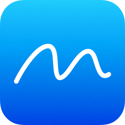

<div align="center">



# MelonARC

**Adaptive Routing Core**

オープンソースでクロスプラットフォームなルールベースのプロキシクライアント。ユーザー定義のルールに従ってトラフィックを異なるアウトバウンドプロトコルへ振り分け、コアデーモンと UI は厳密に分離されています。

[](https://github.com/Melon-tgj/MelonARC/actions/workflows/ci.yml)
[](LICENSE)
[](go.mod)
[](#プラットフォームとビルド成果物)
[](docs/release-notes-0.1.0-preview.1.md)

[English](README.md) · [简体中文](README.zh-CN.md) · **日本語** · [한국어](README.ko.md)

</div>

---

**ステータス：0.x ソースプレビューであり、安定版リリースではありません。** Go コア、ローカル API、CLI、デスクトップフロントエンド、およびネイティブの macOS arm64 シェル（SwiftUI + AppKit）は実装済みです。CI は Xcode 26.3 / Swift 6.2.4 で macOS シェルとそのコア sidecar をビルドします。build 48 が回帰比較の基準であり、その候補 DMG のレイアウトはユーザーの macOS 27 arm64 仮想マシンで受け入れられました。この DMG は ad-hoc 署名済みですが公証はされておらず、Gatekeeper 初回起動、システムプロキシのエンドツーエンド、macOS 13 の確認は未実施です。Windows/Linux のデスクトップシェルは依然として未ビルドで、リリース対象でのエンドツーエンド検証も未完了です。以下のサポートマトリクスが「実際に何が検証されたか」の唯一の情報源です。機能一覧を動作する組み合わせの約束として読まないでください。

## サポートマトリクス

### 用語の意味

- **Verified（検証済み）** — 独立したアウトバウンドクライアントが、バージョンを固定したリファレンスサーバー経由でペイロードを独立したエコーエンドポイントへ届け、戻りバイトを比較したもの。行ごとに環境とリファレンスバージョンを明記します。
- **Project record（プロジェクト記録）** — 本プロジェクト自身のテストハーネスで合格し、固定したリファレンスバージョンとともに `DEVLOG.md` に記録されたもの。外部レビューによる独立した再実行はされていません。
- **Unit-tested only（単体テストのみ）** — 既知回答・負例・インプロセスのテストは合格していますが、リファレンスサーバーへトラフィックを流したことはありません。
- **Unusable（使用不可）** — 外部レビューで見つかった欠陥は修正済みですが、その後リファレンスサーバーへトラフィックを流していません。修正の反映は使用可能を意味しません。安定版の主張からは除外され、安定パッケージに含めてはなりません。
- **Unverified（未検証）** — どちらの環境でもその組み合わせの証拠がありません。

「TCP ビジネス」「UDP ビジネス」は、その下層のトランスポートではなく、プロキシが運んだペイロードを指します。QUIC アウトバウンドでは TCP ビジネスは QUIC ストリーム上を流れます。

### アウトバウンドプロトコル

| アウトバウンド | TCP ビジネス | UDP ビジネス | 証拠と境界 |
|---|---|---|---|
| Shadowsocks レガシー AEAD（`aes-256-gcm`）および 2022 スイート（`blake3-aes-128-gcm`、`blake3-aes-256-gcm`、`blake3-chacha20-poly1305`） | **Verified** 4/4 | **Verified** 4/4 | 外部レビュー、2026-11-15、macOS arm64、shadowsocks-rust 1.25.0、リポジトリ本来の相互運用ケース。他の 2 つのレガシー AEAD スイートには個別のケースがまだ必要です。 |
| VMess (AEAD)、Trojan、VLESS + TLS | **Verified** 3/3 | **Verified** 3/3 | 同じレビュー、Xray-core 26.11.9、リポジトリ本来の相互運用ケース。範囲は設定されたこの 3 ケースちょうどです。 |
| VLESS + REALITY | **Project record**（ステージ 16 TCP、16 KiB 往復） | **Unverified** | ステージ 16 で手書きの TLS 1.3 ハンドシェイクを、固定した uTLS クライアント（`v1.8.3-0.20261108164504-a13c59ffe98b`、Xray-core 26.11.9 が固定するバージョン）と、REALITY の資格情報処理だけを行うアダプタに置き換えました。スクリプト化されたピアにより、サーバー認証セグメントを省略・複製・並べ替えできないこと、誤った署名・誤った資格情報・信頼サイトの証明書・誤った Finished のいずれでも VLESS バイトが 1 バイトも書かれる前に接続が閉じることが証明されています。Xray-core 26.11.9 に対して相互運用を再実行済み（バイナリ SHA-256 `e87bce58…6a66d`）：TCP 16 KiB 往復が合格。UDP の証拠はまだありません。 |
| Snell v4 / v5 | **Verified**（CI、2026-11-16） | **Verified**（CI、2026-11-16） | ステージ 11 で固定した Snell リファレンスサーバーに対して両バージョンの TCP を先に通しました。その後、完全な相互運用ゲートを CI（GitHub Actions、ubuntu、2026-11-16）で snell-server 5.0.0 の両バージョン設定に対して実行：すべての Snell ケースが合格し、TCP・UDP ビジネスとも同様です。同系列の 1 回の実行では、コードツリーが同一のまま UDP サブテスト 2 件だけが失敗し、次の実行で合格したため、一過性の失敗として記録されています（チェックリスト B6）。ゲートは再発時に完全なテスト出力を出力します。 |
| SOCKS5 (+TLS)、HTTP / HTTPS アウトバウンド | **Unit-tested only** | **Unverified** | 本プロジェクトのテストでカバーされています。外部リファレンスサーバーのマトリクスには含まれません。 |
| Hysteria2 | **Verified** | **Verified** | 外部レビュー（2026-11-15）：固定した Hysteria 2.13.0 に対する 3 ラウンドのエコー試行がすべて失敗。HTTP/3 ステージで QPACK フィールドセクションのデコード失敗（エラー 512）が報告されました。ステージ 15 で HTTP/3 ヘッダーブロックを修正し、既知回答テストを追加。7 つのリファレンススロットをすべて揃えた CI（GitHub Actions、ubuntu、2026-11-16）で再実行：Hysteria2 の相互運用ケースが合格し、TCP・UDP ビジネスとも同様です。 |
| TUIC v5 | **Verified** | **Verified** | 外部レビュー（2026-11-15）：固定した tuic-server 1.0.0 に対する 3 ラウンドのエコー試行がすべて失敗。サーバーログは、exporter ラベルに UUID のテキスト形式を使ったことが原因の認証失敗を示しました。ステージ 15 でそのラベルを修正し、既知回答テストを追加。7 つのリファレンススロットをすべて揃えた CI（GitHub Actions、ubuntu、2026-11-16）で再実行：TUIC の相互運用ケースが合格し、TCP・UDP ビジネスとも同様です。 |

ステージ 15 では QUIC テストフィクスチャ、TUIC exporter ラベル、HTTP/3 QPACK ヘッダーブロックを修正し、それぞれに既知回答テストを追加しました。ローカルサンドボックスは未接続のデータグラムソケットに対する `sendto` を拒否するため、QUIC の初回フライトはこのマシンを離れられません。そのため再実行は CI（GitHub Actions、2026-11-16）で行われ、両プロトコルとも固定したリファレンスサーバーに対して合格しました（上記 2 行の記録どおり）。相互運用の未決項目は残っていません。同 CI 系列ではすべての Snell ケースも実行されました（途中の 1 回の一過性失敗については Snell の行と `docs/pre-release-checklist.md` の B6 を参照）。

VLESS の `xtls-rprx-vision` フローは設定時点で拒否され、サポートされません。

### プラットフォームとビルド成果物

| ターゲット | ステータス | 証拠と境界 |
|---|---|---|
| Linux x86_64 | このワークスペースでソースビルドとテストが合格 | `go build ./...`、`go vet ./...`、`go test ./...`、`gofmt`、フロントエンドのオフラインスイートがここで動きます。インストーラ、パッケージ化されたリリース、長時間のソークテストはありません。 |
| Windows x86_64 | **クロスコンパイルのみ** | `GOOS=windows go build ./cmd/... ./internal/...` が成功。外部レビューも両ターゲットで `CGO_ENABLED=0` ビルドを行いました。ネイティブ実行は一切なし：インストーラ、ランタイムテスト、デバイスセッションはありません。Windows TUN デバイスの入口は今も「session not implemented」を返します。 |
| macOS arm64 | 宣言済みのプレビュー対象：ネイティブシェルは CI でビルド | ネイティブの SwiftUI + AppKit シェルが Go コア sidecar を監視します。システムプロキシモードのみで、macOS の TUN は未実装です。CI は Xcode 26.3 / Swift 6.2.4 で両方のバイナリをビルドし ad-hoc 署名します。build 48 が回帰基準で、その候補 DMG のレイアウトはユーザーの macOS 27 arm64 仮想マシンで受け入れられました。最低展開ターゲットは 13.0 ですが、実際に試したのは macOS 27 のみで、13.x は未実施、DMG は未公証です。Gatekeeper 初回起動とシステムプロキシのエンドツーエンド確認も未実施です。 |
| デスクトップアプリ | フロントエンドはテスト済み、macOS ネイティブシェルはビルド済み、Windows/Linux の Tauri シェルは**未ビルド** | フロントエンドのオフラインおよび実コア接続スイートが合格。macOS arm64 のネイティブシェルは CI でビルドされ DMG として配布されます（前の行を参照）。Windows/Linux 向けの Tauri シェルはここでコンパイルされたことがなく（`rustc`/`cargo`/WebKitGTK なし）、`Cargo.lock` も、それ用のネイティブウィンドウのスクリーンショットやネイティブ IPC テストもありません。それらのプラットフォームでは、プロセスホスティング、単一インスタンスロック、シェル設定ファイルはいずれもソースとしてのみ存在し、**実行されたことがありません**。 |

開発ドキュメントが約束する「両プラットフォームへのインストール可能なビルド、常駐トレイ、動作するシステムプロキシと TUN、全プロトコル接続、全性能数値の実測」は**まだ達成されていません**。将来の受け入れ基準として扱い、このツリーの説明としては読まないでください。

### コンポーネント

| コンポーネント | ステータス | 境界 |
|---|---|---|
| HTTP / SOCKS5 インバウンド、ローカル DNS、インデックス化ルールエンジン、ポリシーグループ、リロード、ローカル API、CLI | 実装済み。このワークスペースで単体/統合テスト済み | クリーンな対象インストール上でのインバウンドからアウトバウンドへの完全な転送はまだ記録されていません。 |
| TUN インバウンド | Linux：ソース実装済み、IPv4 ユーザー空間 TCP のみ。Windows：デバイスセッション未実装 | ゼロウィンドウ、再送、順序入れ替え、ハーフクローズ、長接続の挙動は未検証です。 |
| システムプロキシ | 永続化されたスナップショットを引き継いで復元 | 復元は、本プログラムが書いた値と今も一致するフィールドだけを戻し、以前は存在しなかった値を削除します。実行中の Windows アプリへの設定更新ブロードキャストは未検証。Linux バックエンドは gsettings デスクトップ環境のみを対象とします。 |
| 観測履歴 | 純 Go ドライバ（`modernc.org/sqlite` v1.62.0）経由の SQLite 内の上限付きローカルテーブル | 3 つのテーブルはフラッシュごとに丸ごと書き換えられます。スキーマが未知、または読み取れないファイルは変更されずに保持され、書き込みは停止します。本ビルドが理解できない履歴が置き換えられることは決してありません。 |
| デスクトップフロントエンド | 登録済みパネル 6 つ、ロケール 2 つ、オフラインおよび実コア接続テストが合格 | 開発用プレビューブリッジに対してのみ動作します。そのブリッジは開発専用であり、本番パッケージに含めてはなりません。コアのプロセス状態を報告するパネルはシェルから状態を読むため、ブラウザ上ではブリッジ自身の子プロセス（`--core` 使用時）か、誰かが既に起動したコアへの実際のプローブのどちらかを表示します。ブリッジが作り出した pid は決して表示しません。 |

### パフォーマンス

開発ドキュメントの 5 つの性能目標は**実機で測定されていません**。公開されているルールマッチの数値は、異なるマシン・異なるステージで得た固定ルールセットのマイクロベンチマークであり、スループット、テールレイテンシ、メモリ使用量、クロスプラットフォーム適合へ外挿することはできません。リリースの数値にはすべて、専用の有線テストリグ、固定したビルドと設定ハッシュ、直接/プロキシの交互実行、生サンプルをリリース記録とともに保持することが必要です。

### その他の既知の不足

- どちらのリリース対象にも、ネイティブインストーラ、トレイ、自動起動、署名済み成果物がありません。
- パッケージ化されたインストールから、インバウンドリスナー経由でアウトバウンドプロトコルまでのエンドツーエンドの証拠がありません。
- 長時間実行、公衆ネットワーク、マルチプロセス、クラッシュリカバリの結果がありません。
- デスクトップシェルのデータディレクトリと API アドレスは今も GUI の再起動で有効になります。コアバイナリのパスとコア設定は次回のコア起動時に有効になります（設定パネルからコアを再起動できます）。
- 設定パーサー、共有リンク、サブスクリプション本文、DNS 応答に対する fuzz ターゲットとシードコーパスが存在します。いずれもローカルの制限時間セッションでしか実行されておらず、CI ジョブではまだ実行されません。
- 独立した相互運用ジョブを持つ CI ワークフローが Actions で動作しています。2026-11-16 時点で 3 つのジョブ（Go、Frontend、Interop）はすべてグリーンで、相互運用ジョブは固定したリファレンスサーバーに対して Hysteria2、TUIC v5、Snell を再検証しました。リリースタグの背後にあるマシンレポートはまだありません。

## ソースレベルの範囲

以下はソースツリーに存在するものです。その検証ステータスは上記のマトリクスのとおりです。

### インバウンド
- HTTP / SOCKS5 プロキシサービス（ローカルリスナー、任意の認証）
- コアの起動と停止に追随するシステムプロキシ設定
- TUN モード（Linux：tun デバイスとルート設定。Windows：デバイスバインディングのみ）

### アウトバウンドプロトコル
- Shadowsocks（2022 暗号スイートを含む）
- VMess (AEAD)
- VLESS（REALITY を含む。XTLS-Vision フローは受け付けません）
- Trojan
- Snell v4 / v5
- Hysteria2、TUIC v5 —— CI で固定したリファレンスサーバーに対して検証済み（2026-11-16）
- SOCKS5（TLS バリアントを含む）
- HTTP / HTTPS

### ルールエンジン
- ルールタイプ：DOMAIN、DOMAIN-SUFFIX、DOMAIN-KEYWORD、DOMAIN-SET、IP-CIDR、IP-CIDR6、GEOIP、IP-ASN、RULE-SET、DEST-PORT、PROTOCOL、FINAL
- 外部ルールセット（RULE-SET / DOMAIN-SET）：定期更新、ローカルインデックス、循環参照の検出
- 保存前の設定全体の検証：ルールセット参照の存在、ポリシー参照の存在、FINAL の存在。無効な設定は決して有効になりません
- ルールマッチの説明：ドメインまたは IP を与えると、マッチしたルールと決定経路を表示（CLI を優先）

### ポリシーグループ
- Select（手動選択）
- URL-Test（定期的なレイテンシ計測で最速を選択）
- Fallback（順序付きフェイルオーバー）

### 設定とインポート
- ネイティブ設定：INI 形式のセクション付きプレーンテキスト（`[General]` / `[Proxy]` / `[Proxy Group]` / `[Rule]` / `[Host]`）。手編集可能でバージョン管理に適しています
- 共有リンクのインポート：`vmess://`、`vless://`、`ss://`、`trojan://`、`hysteria2://`、`tuic://` など
- 定期更新付きのサブスクリプションインポート
- GeoIP / ASN データベース：mmdb 形式互換

### インターフェースと可観測性
- メインウィンドウ：設定の切り替え、アウトバウンドとポリシーグループの一覧と切り替え、接続一覧、トラフィック系列、ログビューア
- 接続ログとトラフィック統計をローカルに永続化（上限付きテーブル）

各ステージの詳細、リファレンスバージョン、残作業は `DEVLOG.md` に記録されています。

## リポジトリ構成

```
cmd/melonarc-core   コアデーモンのエントリポイント
cmd/melonarc-cli    コマンドラインクライアントのエントリポイント
apps/desktop        デスクトップフロントエンドと（まだコンパイルされていない）ネイティブシェル
internal/           コアパッケージ（config、rules、policy、outbound、inbound、dns、api、cli、datadir、store、sysproxy）
spikes/             技術検証プロトタイプとその結果
docs/               設計・開発ドキュメント
```

## ビルド

Go 1.27 以降が必要です。

```
go build ./...
GOOS=windows go build ./cmd/... ./internal/...
```

2 つ目のコマンドはクロスコンパイルのチェックのみであり、検証済みの Windows ビルドを生み出すものではありません。

## ライセンス

MelonARC は GNU General Public License バージョン 3 の下でライセンスされています。ライセンス全文は [LICENSE](LICENSE) にあります。

サードパーティコンポーネントは、そのライセンスが GPLv3 と互換する場合にのみ追加でき、それぞれのバージョン、ライセンス、用途を `DEVLOG.md` に登録します。[THIRD-PARTY-NOTICES.md](THIRD-PARTY-NOTICES.md) には、配布バイナリに到達するもの（ライセンスは各コンポーネント自身の副本から読んだもの）と、まだ監査されていない唯一の部分（Rust シェル）の名前が記載されています。これはリリースアーカイブに同梱されます。
