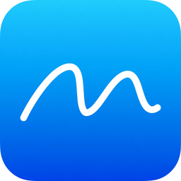

<div align="center">



# MelonARC

**Adaptive Routing Core**

오픈 소스, 크로스 플랫폼 규칙 기반 프록시 클라이언트입니다. 사용자가 정의한 규칙에 따라 트래픽을 서로 다른 아웃바운드 프로토콜로 분배하며, 코어 데몬과 UI는 엄격히 분리되어 있습니다.

[](https://github.com/Melon-tgj/MelonARC/actions/workflows/ci.yml)
[](LICENSE)
[](go.mod)
[](#플랫폼과-빌드-산출물)
[](docs/release-notes-0.1.0-preview.1.md)

[English](README.md) · [简体中文](README.zh-CN.md) · [日本語](README.ja.md) · **한국어**

</div>

---

**상태: 0.x 소스 프리뷰이며 안정 릴리스가 아닙니다.** Go 코어, 로컬 API, CLI, 데스크톱 프런트엔드, 그리고 네이티브 macOS arm64 셸(SwiftUI + AppKit)이 구현되어 있습니다. CI는 Xcode 26.3 / Swift 6.2.4로 macOS 셸과 코어 sidecar를 빌드합니다. build 48이 회귀 비교 기준이며, 해당 후보 DMG의 레이아웃은 사용자의 macOS 27 arm64 가상 머신에서 확인되었습니다. 이 DMG는 ad-hoc 서명되었지만 공증되지 않았고, Gatekeeper 첫 실행, 시스템 프록시 종단 간 확인, macOS 13 확인은 아직 남아 있습니다. Windows/Linux 데스크톱 셸은 여전히 빌드되지 않았고 릴리스 대상에서의 종단 간 검증도 끝나지 않았습니다. 아래 지원 매트릭스가 실제로 무엇이 검증되었는지에 대한 유일한 사실 출처입니다. 기능 목록을 동작하는 조합에 대한 약속으로 읽지 마십시오.

## 지원 매트릭스

### 용어의 의미

- **Verified(검증됨)** — 독립적인 아웃바운드 클라이언트가 버전을 고정한 레퍼런스 서버를 거쳐 페이로드를 독립적인 에코 엔드포인트까지 전달했고, 반환된 바이트를 비교한 경우입니다. 해당 행에 환경과 레퍼런스 버전이 명시됩니다.
- **Project record(프로젝트 기록)** — 이 프로젝트 자체의 테스트 하네스에서 통과했고, 고정한 레퍼런스 버전과 함께 `DEVLOG.md`에 기록된 경우입니다. 외부 검토가 독립적으로 재실행한 것은 아닙니다.
- **Unit-tested only(단위 테스트만)** — 알려진 답, 음성, 인프로세스 테스트는 통과했지만 레퍼런스 서버로 트래픽을 보낸 적은 없습니다.
- **Unusable(사용 불가)** — 외부 검토에서 발견된 결함은 수정되었지만, 그 이후 레퍼런스 서버로 트래픽을 보낸 적이 없습니다. 수정이 반영되었다고 해서 사용할 수 있는 것은 아닙니다. 안정 버전에 대한 어떤 주장에서도 제외되며 안정 패키지에 포함되어서는 안 됩니다.
- **Unverified(미검증)** — 두 환경 모두에서 해당 조합에 대한 증거가 없습니다.

"TCP 비즈니스"와 "UDP 비즈니스"는 그 아래의 전송이 아니라 프록시가 운반한 페이로드를 뜻합니다. QUIC 아웃바운드에서는 TCP 비즈니스가 QUIC 스트림 위로 흐릅니다.

### 아웃바운드 프로토콜

| 아웃바운드 | TCP 비즈니스 | UDP 비즈니스 | 증거와 경계 |
|---|---|---|---|
| Shadowsocks 레거시 AEAD(`aes-256-gcm`) 및 2022 스위트(`blake3-aes-128-gcm`, `blake3-aes-256-gcm`, `blake3-chacha20-poly1305`) | **Verified** 4/4 | **Verified** 4/4 | 외부 검토, 2026-11-15, macOS arm64, shadowsocks-rust 1.25.0, 저장소 본래의 상호운용 케이스. 나머지 두 레거시 AEAD 스위트는 각각의 케이스가 아직 필요합니다. |
| VMess(AEAD), Trojan, VLESS + TLS | **Verified** 3/3 | **Verified** 3/3 | 같은 검토, Xray-core 26.11.9, 저장소 본래의 상호운용 케이스. 범위는 구성된 이 세 케이스 정확히 그만큼입니다. |
| VLESS + REALITY | **Project record**(스테이지 16 TCP, 16 KiB 왕복) | **Unverified** | 스테이지 16에서 손으로 작성한 TLS 1.3 핸드셰이크를 고정한 uTLS 클라이언트(`v1.8.3-0.20261108164504-a13c59ffe98b`, Xray-core 26.11.9가 고정하는 버전)와 REALITY 자격 증명 작업만 수행하는 어댑터로 교체했습니다. 스크립트로 구동되는 피어는 서버 인증 구간을 건너뛰거나 복제하거나 순서를 바꿀 수 없으며, 잘못된 서명, 잘못된 자격 증명, 신뢰 사이트 인증서, 잘못된 Finished 중 어느 경우에도 VLESS 바이트가 한 바이트도 쓰이기 전에 연결이 닫힘을 증명합니다. Xray-core 26.11.9에 대해 상호운용을 재실행했습니다(바이너리 SHA-256 `e87bce58…6a66d`): TCP 16 KiB 왕복 통과. UDP 증거는 아직 없습니다. |
| Snell v4 / v5 | **Verified**(CI, 2026-11-16) | **Verified**(CI, 2026-11-16) | 스테이지 11에서 고정한 Snell 레퍼런스 서버에 대해 두 버전의 TCP를 먼저 통과시켰습니다. 이후 전체 상호운용 게이트가 CI(GitHub Actions, ubuntu, 2026-11-16)에서 snell-server 5.0.0의 두 버전 구성 모두에 대해 실행되었습니다: 모든 Snell 케이스가 통과했고 TCP와 UDP 비즈니스 모두 마찬가지입니다. 같은 시리즈의 한 실행에서는 코드 트리가 동일한 상태에서 UDP 서브테스트 두 개만 실패했고 다음 실행에서 통과했으므로 일시적 실패로 기록됩니다(체크리스트 B6). 게이트는 재발 시 전체 테스트 출력을 출력합니다. |
| SOCKS5(+TLS), HTTP / HTTPS 아웃바운드 | **Unit-tested only** | **Unverified** | 이 프로젝트의 테스트로 커버됩니다. 외부 레퍼런스 서버 매트릭스에는 포함되지 않습니다. |
| Hysteria2 | **Verified** | **Verified** | 외부 검토(2026-11-15): 고정한 Hysteria 2.13.0에 대한 세 라운드의 에코 시도가 모두 실패했고, HTTP/3 단계에서 QPACK 필드 섹션 디코딩 실패(오류 512)가 보고되었습니다. 스테이지 15에서 HTTP/3 헤더 블록을 수정하고 알려진 답 테스트를 추가했습니다. 일곱 개의 레퍼런스 슬롯을 모두 채운 CI(GitHub Actions, ubuntu, 2026-11-16)에서 재실행: Hysteria2 상호운용 케이스가 통과했고 TCP와 UDP 비즈니스 모두 마찬가지입니다. |
| TUIC v5 | **Verified** | **Verified** | 외부 검토(2026-11-15): 고정한 tuic-server 1.0.0에 대한 세 라운드의 에코 시도가 모두 실패했고, 서버 로그는 exporter 라벨에 UUID의 텍스트 형식을 사용한 것이 원인인 인증 실패를 보여 주었습니다. 스테이지 15에서 그 라벨을 수정하고 알려진 답 테스트를 추가했습니다. 일곱 개의 레퍼런스 슬롯을 모두 채운 CI(GitHub Actions, ubuntu, 2026-11-16)에서 재실행: TUIC 상호운용 케이스가 통과했고 TCP와 UDP 비즈니스 모두 마찬가지입니다. |

스테이지 15에서는 QUIC 테스트 픽스처, TUIC exporter 라벨, HTTP/3 QPACK 헤더 블록을 수정하고 각각에 알려진 답 테스트를 추가했습니다. 로컬 샌드박스는 연결되지 않은 데이터그램 소켓에 대한 `sendto`를 거부하므로 QUIC 첫 비행은 이 머신을 떠날 수 없습니다. 그래서 재실행은 CI(GitHub Actions, 2026-11-16)에서 이루어졌고, 두 프로토콜 모두 고정된 레퍼런스 서버에 대해 통과했습니다(위 두 행의 기록과 같습니다). 상호운용 미결 항목은 남아 있지 않습니다. 같은 CI 시리즈에서 모든 Snell 케이스도 실행되었습니다(도중의 한 번의 일시적 실패는 Snell 행과 `docs/pre-release-checklist.md`의 B6 항목 참조).

VLESS의 `xtls-rprx-vision` 플로는 구성 시점에 거부되며 지원되지 않습니다.

### 플랫폼과 빌드 산출물

| 대상 | 상태 | 증거와 경계 |
|---|---|---|
| Linux x86_64 | 이 워크스페이스에서 소스 빌드와 테스트 통과 | `go build ./...`, `go vet ./...`, `go test ./...`, `gofmt`와 프런트엔드 오프라인 스위트가 여기서 실행됩니다. 설치 프로그램, 패키징된 릴리스, 장시간 소크 테스트는 없습니다. |
| Windows x86_64 | **크로스 컴파일만** | `GOOS=windows go build ./cmd/... ./internal/...` 성공. 외부 검토도 두 대상 모두에 대해 `CGO_ENABLED=0` 빌드를 수행했습니다. 네이티브로 실행된 적은 전혀 없습니다: 설치 프로그램, 런타임 테스트, 디바이스 세션이 없습니다. Windows TUN 디바이스 진입점은 여전히 "session not implemented"를 반환합니다. |
| macOS arm64 | 선언된 프리뷰 대상: 네이티브 셸은 CI로 빌드 | 네이티브 SwiftUI + AppKit 셸이 Go 코어 sidecar를 감독합니다. 시스템 프록시 모드만 지원하며 macOS TUN은 구현되지 않았습니다. CI가 Xcode 26.3 / Swift 6.2.4로 두 바이너리를 빌드하고 ad-hoc 서명합니다. build 48이 회귀 기준이며, 해당 후보 DMG의 레이아웃은 사용자의 macOS 27 arm64 가상 머신에서 확인되었습니다. 최소 배포 대상은 13.0이지만 실제로 확인한 운영체제는 macOS 27뿐이고 13.x는 남아 있으며 DMG는 공증되지 않았습니다. Gatekeeper 첫 실행과 시스템 프록시 종단 간 확인도 아직 남아 있습니다. |
| 데스크톱 애플리케이션 | 프런트엔드는 테스트됨, macOS 네이티브 셸은 빌드됨, Windows/Linux의 Tauri 셸은 **빌드되지 않음** | 프런트엔드 오프라인 및 실제 코어 연결 스위트가 통과합니다. macOS arm64 네이티브 셸은 CI로 빌드되어 DMG로 제공됩니다(위 행 참조). Windows/Linux용 Tauri 셸은 여기서 컴파일된 적이 없고(`rustc`/`cargo`/WebKitGTK 없음) `Cargo.lock`, 해당 플랫폼의 네이티브 창 스크린샷, 네이티브 IPC 테스트도 없습니다. 그 플랫폼에서는 프로세스 호스팅, 단일 인스턴스 잠금, 셸 설정 파일이 소스로만 존재하며 **실행된 적이 없습니다**. |

개발 문서가 약속하는 "두 플랫폼 모두에 설치 가능한 빌드, 상주 트레이, 동작하는 시스템 프록시와 TUN, 모든 프로토콜 연결, 모든 성능 수치 실측"은 **아직 달성되지 않았습니다**. 미래의 인수 기준으로 취급하고, 이 트리에 대한 설명으로 읽지 마십시오.

### 구성 요소

| 구성 요소 | 상태 | 경계 |
|---|---|---|
| HTTP / SOCKS5 인바운드, 로컬 DNS, 인덱싱된 규칙 엔진, 정책 그룹, 리로드, 로컬 API, CLI | 구현됨. 이 워크스페이스에서 단위/통합 테스트됨 | 깨끗한 대상 설치에서의 인바운드에서 아웃바운드까지의 전체 전달은 아직 기록되지 않았습니다. |
| TUN 인바운드 | Linux: 소스 구현됨, IPv4 사용자 공간 TCP만. Windows: 디바이스 세션 미구현 | 제로 윈도우, 재전송, 순서 바뀜, 반쯤 닫힘, 장시간 연결 동작은 검증되지 않았습니다. |
| 시스템 프록시 | 디스크에 저장된 스냅샷을 인계받아 복원 | 복원은 이 프로그램이 쓴 값과 여전히 같은 필드만 되돌리고, 이전에 없던 값은 삭제합니다. 이미 실행 중인 Windows 앱에 대한 설정 새로고침 브로드캐스트는 검증되지 않았습니다. Linux 백엔드는 gsettings 데스크톱 환경만 다룹니다. |
| 관측 기록 | 순수 Go 드라이버(`modernc.org/sqlite` v1.62.0)를 통한 SQLite의 상한 있는 로컬 테이블 | 세 테이블은 플러시할 때마다 전체가 다시 쓰입니다. 스키마를 알 수 없거나 읽을 수 없는 파일은 변경 없이 보존되고 쓰기가 중단되므로, 이 빌드가 이해하지 못하는 기록이 대체되는 일은 결코 없습니다. |
| 데스크톱 프런트엔드 | 등록된 패널 여섯 개, 로캘 두 개, 오프라인 및 실제 코어 연결 테스트 통과 | 개발 프리뷰 브리지에 대해서만 동작합니다. 그 브리지는 개발 전용이며 프로덕션 패키지에 포함되어서는 안 됩니다. 코어의 프로세스 상태를 보고하는 패널은 셸에서 상태를 읽으므로, 브라우저에서는 브리지 자체의 자식 프로세스(`--core` 사용 시)나 누군가 이미 시작한 코어에 대한 실제 프로브 중 하나를 표시합니다. 브리지가 지어낸 pid는 결코 표시하지 않습니다. |

### 성능

개발 문서의 다섯 가지 성능 목표는 **실제 하드웨어에서 측정되지 않았습니다**. 공개된 규칙 매칭 수치는 서로 다른 머신과 서로 다른 스테이지에서 얻은 고정 규칙 집합의 마이크로벤치마크이며, 처리량, 꼬리 지연, 메모리 사용량, 크로스 플랫폼 적합성으로 외삽할 수 없습니다. 모든 릴리스 수치는 전용 유선 테스트 리그, 고정된 빌드와 구성 해시, 직접/프록시 교대 실행, 원본 샘플을 릴리스 기록과 함께 보관하는 것을 필요로 합니다.

### 그 밖의 알려진 부족 사항

- 두 릴리스 대상 모두 네이티브 설치 프로그램, 트레이, 자동 시작, 서명된 산출물이 없습니다.
- 패키징된 설치에서 인바운드 리스너를 거쳐 아웃바운드 프로토콜까지의 종단 간 증거가 없습니다.
- 장시간 실행, 공용 네트워크, 다중 프로세스, 충돌 복구 결과가 없습니다.
- 데스크톱 셸의 데이터 디렉터리와 API 주소는 여전히 GUI를 재시작해야 적용됩니다. 코어 바이너리 경로와 코어 구성은 다음 코어 시작 시 적용됩니다(설정 패널에서 코어를 재시작할 수 있습니다).
- 구성 파서, 공유 링크, 구독 본문, DNS 응답에 대한 퍼즈 대상과 시드 코퍼스가 존재합니다. 각각 로컬에서 시간 제한 세션으로만 실행되었고, 아직 이를 실행하는 CI 작업은 없습니다.
- 독립적인 상호운용 작업을 갖춘 CI 워크플로가 Actions에서 동작합니다. 2026-11-16 기준으로 세 작업(Go, Frontend, Interop)이 모두 그린이었고, 상호운용 작업은 고정된 레퍼런스 서버에 대해 Hysteria2, TUIC v5, Snell을 재검증했습니다. 아직 릴리스 태그 뒤에 있는 머신 보고서는 없습니다.

## 소스 수준 범위

아래는 소스 트리에 존재하는 것들입니다. 검증 상태는 위의 매트릭스와 같습니다.

### 인바운드
- HTTP / SOCKS5 프록시 서비스(로컬 리스너, 선택적 인증)
- 코어의 시작과 중지를 따르는 시스템 프록시 설정
- TUN 모드(Linux: tun 디바이스와 라우트 구성. Windows: 디바이스 바인딩만)

### 아웃바운드 프로토콜
- Shadowsocks(2022 암호 스위트 포함)
- VMess(AEAD)
- VLESS(REALITY 포함. XTLS-Vision 플로는 허용되지 않음)
- Trojan
- Snell v4 / v5
- Hysteria2, TUIC v5 — CI에서 고정된 레퍼런스 서버에 대해 검증됨(2026-11-16)
- SOCKS5(TLS 변형 포함)
- HTTP / HTTPS

### 규칙 엔진
- 규칙 유형: DOMAIN, DOMAIN-SUFFIX, DOMAIN-KEYWORD, DOMAIN-SET, IP-CIDR, IP-CIDR6, GEOIP, IP-ASN, RULE-SET, DEST-PORT, PROTOCOL, FINAL
- 외부 규칙 집합(RULE-SET / DOMAIN-SET): 정기 업데이트, 로컬 인덱싱, 순환 참조 감지
- 저장 전 전체 구성 검증: 규칙 집합 참조 존재, 정책 참조 존재, FINAL 존재. 유효하지 않은 구성은 절대 적용되지 않습니다
- 규칙 매칭 설명: 도메인이나 IP를 주면 매칭된 규칙과 결정 경로를 출력합니다(CLI 우선)

### 정책 그룹
- Select(수동 선택)
- URL-Test(주기적 지연 측정, 가장 빠른 것 선택)
- Fallback(순서 있는 장애 전환)

### 구성과 가져오기
- 네이티브 구성: INI 스타일의 섹션 구분 일반 텍스트(`[General]` / `[Proxy]` / `[Proxy Group]` / `[Rule]` / `[Host]`). 손으로 편집할 수 있고 버전 관리에 친화적입니다
- 공유 링크 가져오기: `vmess://`, `vless://`, `ss://`, `trojan://`, `hysteria2://`, `tuic://` 등
- 정기 업데이트를 지원하는 구독 가져오기
- GeoIP / ASN 데이터베이스: mmdb 형식 호환

### 인터페이스와 관측 가능성
- 메인 창: 구성 전환, 아웃바운드와 정책 그룹 목록 및 전환, 연결 목록, 트래픽 시계열, 로그 뷰어
- 연결 로그와 트래픽 통계를 로컬에 영속화(상한 있는 테이블)

각 스테이지의 세부 사항, 레퍼런스 버전, 남은 작업은 `DEVLOG.md`에 기록되어 있습니다.

## 저장소 구성

```
cmd/melonarc-core   코어 데몬 진입점
cmd/melonarc-cli    명령줄 클라이언트 진입점
apps/desktop        데스크톱 프런트엔드와 (아직 컴파일되지 않은) 네이티브 셸
internal/           코어 패키지(config, rules, policy, outbound, inbound, dns, api, cli, datadir, store, sysproxy)
spikes/             기술 검증 프로토타입과 그 결과
docs/               설계 및 개발 문서
```

## 빌드

Go 1.27 이상이 필요합니다.

```
go build ./...
GOOS=windows go build ./cmd/... ./internal/...
```

두 번째 명령은 크로스 컴파일 확인일 뿐이며, 검증된 Windows 빌드를 만들지 않습니다.

## 라이선스

MelonARC는 GNU General Public License 버전 3에 따라 라이선스가 부여됩니다. 라이선스 전문은 [LICENSE](LICENSE)에 있습니다.

서드파티 구성 요소는 그 라이선스가 GPLv3와 호환될 때만 추가할 수 있으며, 각각의 버전, 라이선스, 용도를 `DEVLOG.md`에 등록합니다. [THIRD-PARTY-NOTICES.md](THIRD-PARTY-NOTICES.md)에는 배포 바이너리에 도달하는 것들(라이선스는 각 구성 요소 자체의 사본에서 읽은 것)과 아직 감사되지 않은 유일한 부분(Rust 셸)의 이름이 나열되어 있습니다. 이 파일은 릴리스 아카이브에 함께 제공됩니다.
